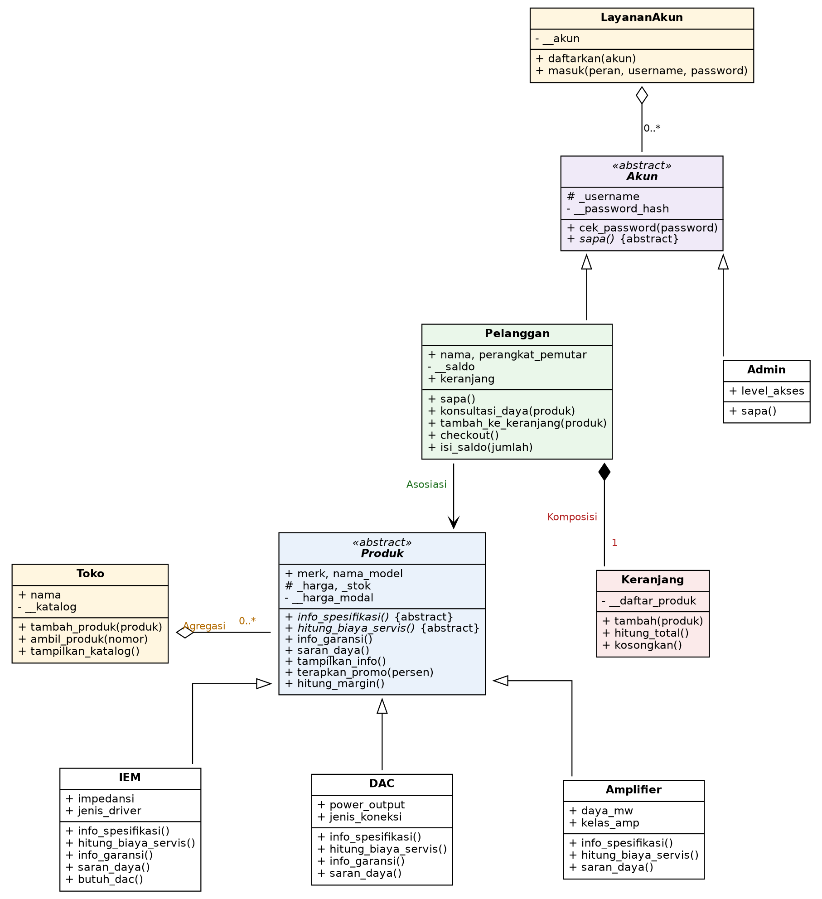

# Posttest 3 - Pemrograman Berorientasi Objek

## Audiophile HS Store: Abstraksi & Polimorfisme

## 1. Deskripsi Program

Audiophile HS Store adalah aplikasi toko perangkat audio berbasis terminal yang berjalan interaktif lewat menu. Program dimulai dari **menu awal** (Login, Register, Info arsitektur), lalu pengguna masuk sebagai **user** (pelanggan) atau **admin**, dan masing-masing mendapat menu sendiri.

- **User** dapat melihat katalog, membaca detail produk, berkonsultasi soal daya IEM, mengisi keranjang, checkout dengan diskon member, dan mengisi saldo.
- **Admin** dapat menambah produk, mengubah stok dan harga, memberi promo, mengubah diskon member, serta melihat laporan margin dan biaya servis.

Produk yang dijual ada tiga jenis: **IEM**, **DAC**, dan **Amplifier**. Program ini melanjutkan Posttest 2 dengan judul yang sama, dengan fokus pada **Abstraksi** dan **Polimorfisme**.

### Cara Menjalankan

```bash
python post-test-3.py
```

Struktur folder:

```text
.
├── post-test-3.py
├── README.md
└── images
```

### Akun dan Login

| Peran | Cara mendapatkan akun | Cara login |
|---|---|---|
| **admin** | Sudah tersedia: username `admin`, password `admin123` | Menu 1 (Login), ketik `admin` pada pertanyaan peran, lalu isi username dan password |
| **user** | Daftar sendiri lewat menu 2 (Register akun baru) | Menu 1 (Login), ketik `user` pada pertanyaan peran, lalu isi username dan password |

Aturan akun:

- Username minimal 4 karakter, tanpa spasi, dan harus unik (username `admin` tidak bisa didaftarkan ulang).
- Password minimal 6 karakter dan harus diketik dua kali saat register. Password disimpan dalam bentuk hash SHA-256, bukan teks asli.
- Register hanya membuat akun user. Akun user tidak bisa dipakai login sebagai admin, begitu juga sebaliknya.
- Login diberi 3 kali percobaan sebelum kembali ke menu awal.
- Data akun, produk, dan saldo disimpan di memori, sehingga kembali ke kondisi awal setiap program dijalankan ulang.

### Daftar Menu

**Menu awal**

| Menu | Fungsi |
|---|---|
| 1. Login | Masuk sebagai admin atau user |
| 2. Register akun baru | Membuat akun pelanggan |
| 3. Info arsitektur program | Mencoba membuat objek abstract class dan menampilkan status abstract method tiap subclass |

**Menu user (pelanggan)**

| Menu | Fungsi | Konsep OOP yang terlibat |
|---|---|---|
| 1. Lihat katalog | Semua produk, bisa diurutkan dari termurah | Polimorfisme (`info_spesifikasi()`), operator `__lt__` dan `__str__` |
| 2. Detail produk | Spesifikasi, garansi, estimasi servis, promo maksimal, simulasi cicilan | Method konkret `tampilkan_info()`, override `info_garansi()`, static method |
| 3. Konsultasi daya | Saran apakah produk perlu pendamping (misalnya DAC untuk IEM berat) | Asosiasi, polimorfisme (`saran_daya()`) |
| 4. Tambah ke keranjang | Memasukkan produk dengan pengecekan stok | Komposisi (`Pelanggan` dan `Keranjang`) |
| 5. Lihat keranjang | Isi dan total keranjang | Operator `__int__`, `__add__`, `__radd__`, `__len__` |
| 6. Checkout | Diskon member, cek saldo, kurangi stok, struk | Static method `cek_kelayakan_beli`, atribut private `__saldo` |
| 7. Isi saldo | Menambah saldo dengan validasi | Property setter |
| 8. Ringkasan toko & akun | Ringkasan `Toko`, `Keranjang`, dan `Pelanggan` lewat satu fungsi | Duck typing |

**Menu admin**

| Menu | Fungsi | Konsep OOP yang terlibat |
|---|---|---|
| 1. Lihat katalog | Daftar produk | Polimorfisme |
| 2. Tambah produk baru | Membuat produk IEM, DAC, atau Amplifier dari input | Class method `buat_dari_input()`, OCP |
| 3. Ubah stok produk | Mengubah stok dengan validasi | Property setter, atribut protected `_stok` |
| 4. Ubah harga produk | Mengubah harga dengan validasi | Property setter, atribut protected `_harga` |
| 5. Terapkan promo | Promo dengan batas maksimal berbeda tiap jenis produk | Atribut class `batas_promo` per subclass |
| 6. Ubah diskon member | Mengubah diskon untuk semua pelanggan | Class method `ubah_diskon_member()` |
| 7. Laporan margin & servis | Margin dan biaya servis semua produk | Atribut private `__harga_modal`, polimorfisme |
| 8. Ringkasan toko & akun | Ringkasan `Toko` dan `LayananAkun` lewat satu fungsi | Duck typing |

## 2. Class Diagram dan Relasi UML



Diagram menampilkan nama class, atribut, dan method utama. Simbol yang dipakai: `+` public, `#` protected, `-` private, huruf miring untuk abstract class dan abstract method, segitiga kosong untuk pewarisan.

| Relasi | Dari ke | Penjelasan | Bukti di kode |
|---|---|---|---|
| **Asosiasi** | `Pelanggan` ke `Produk` | `Pelanggan` hanya menggunakan objek produk sebagai parameter method tanpa menyimpannya, dan keduanya tetap hidup sendiri-sendiri. | `Pelanggan.konsultasi_daya(produk)` dan `Pelanggan.tambah_ke_keranjang(produk)` |
| **Agregasi** | `Toko` ke `Produk` | `Toko` menyimpan daftar produk, tetapi produk dibuat di luar `Toko` lalu dimasukkan. Dipilih agregasi karena produk tidak bergantung pada toko, jadi toko hanya menyimpan referensi dan produk tetap ada walau toko tidak ada. | `Toko.tambah_produk(produk)`, dipanggil di `buat_toko_awal()` dan `admin_tambah_produk()` setelah produk dibuat di luar `Toko` |
| **Komposisi** | `Pelanggan` ke `Keranjang` | `Keranjang` dibuat di dalam constructor `Pelanggan`, bukan diberikan dari luar. Dipilih komposisi karena keranjang tidak punya arti tanpa pelanggan pemiliknya, sehingga siklus hidupnya mengikuti pelanggan. | `self.keranjang = Keranjang()` di `Pelanggan.__init__` |

Selain tiga relasi di atas, `LayananAkun` ke `Akun` juga berupa agregasi: akun dibuat di luar (`Admin(...)` di `main()` dan `Pelanggan(...)` di `menu_register()`) lalu didaftarkan lewat `LayananAkun.daftarkan(akun)`.

## 3. Penerapan Abstraksi

Program memiliki dua abstract class.

### 3.1 Abstract class `Produk(ABC)`

| Ketentuan | Penerapan |
|---|---|
| Abstract method (minimal 2) | `info_spesifikasi()` dan `hitung_biaya_servis()` |
| Subclass yang mengimplementasikan semuanya (minimal 2) | `IEM`, `DAC`, dan `Amplifier` |
| Method konkret yang dipakai bersama | `tampilkan_info()`, `info_garansi()`, `saran_daya()`, `terapkan_promo()`, `hitung_margin()`, `kurangi_stok()`, dan `__str__()` |
| Bukti tidak bisa diinstansiasi | Menu awal nomor 3 menjalankan `Produk(...)` di dalam `try-except TypeError` (lihat screenshot bagian 7.3) |

Contoh pemakaian method konkret bersama: `tampilkan_info()` di `Produk` dipakai semua subclass tanpa ditulis ulang, dan di dalamnya memanggil `info_spesifikasi()` serta `hitung_biaya_servis()` yang dikerjakan masing-masing subclass.

### 3.2 Abstract class `Akun(ABC)`

| Ketentuan | Penerapan |
|---|---|
| Abstract method | `sapa()` |
| Subclass yang mengimplementasikan | `Pelanggan` dan `Admin` |
| Method konkret yang dipakai bersama | `cek_password()` dan `hash_password()` (static) |
| Bukti tidak bisa diinstansiasi | Ikut ditampilkan di menu awal nomor 3 |

### 3.3 Konsep inheritance dari posttest sebelumnya

| Konsep | Penerapan |
|---|---|
| `super().__init__(...)` | Dipanggil di constructor `IEM`, `DAC`, `Amplifier`, `Pelanggan`, dan `Admin` |
| Atribut unik subclass | `IEM`: `impedansi`, `jenis_driver`. `DAC`: `power_output`, `jenis_koneksi`. `Amplifier`: `daya_mw`, `kelas_amp`. `Pelanggan`: `nama`, `perangkat_pemutar`, `keranjang`. `Admin`: `level_akses` |
| Protected | `_harga` dan `_stok` di `Produk` (dibaca langsung oleh subclass, misalnya `self._harga` di `IEM.hitung_biaya_servis()`), serta `_username` di `Akun` |
| Private | `__harga_modal` di `Produk` (dibaca lewat `hitung_margin()`), `__password_hash` di `Akun`, `__saldo` di `Pelanggan`, serta `__katalog`, `__daftar_produk`, dan `__akun` |

## 4. Penerapan Polimorfisme

### 4.1 Polimorfisme via Pewarisan

Beberapa method di-override dengan perilaku berbeda oleh minimal dua subclass:

| Method | `IEM` | `DAC` | `Amplifier` |
|---|---|---|---|
| `info_garansi()` | 6 bulan, tanpa kabel dan ear tips | 12 bulan resmi | memakai versi `Produk` (6 bulan) |
| `saran_daya()` | Berat atau ringan berdasarkan impedansi | Bertenaga atau hemat daya berdasarkan output | Cocok untuk headphone impedansi tinggi |
| `info_spesifikasi()` (abstract) | Impedansi dan driver | Output dan koneksi | Daya dan kelas |
| `hitung_biaya_servis()` (abstract) | 15% harga | 10% harga ditambah Rp75.000 | Rp100.000 ditambah daya dikali 50 |

Pada class `Akun`, method abstract `sapa()` juga berperilaku berbeda: `Pelanggan` menyebut nama dan saldo, `Admin` menyebut level akses. Setelah login, program cukup memanggil `akun.sapa()` tanpa mengecek peran.

Method-method ini dipanggil lewat loop yang berisi objek dari subclass berbeda, misalnya di `Toko`:

```python
def tampilkan_katalog(self, urut_harga=False):
    produk_tampil = sorted(self.__katalog) if urut_harga else self.__katalog
    for produk in produk_tampil:
        nomor = self.__katalog.index(produk) + 1
        print(f"{nomor:>2}. {produk}")
        print(f"    {produk.info_spesifikasi()}")

def total_biaya_servis(self):
    return sum(produk.hitung_biaya_servis() for produk in self.__katalog)
```

### 4.2 Duck Typing

`Toko`, `Keranjang`, `Pelanggan`, dan `LayananAkun` tidak berelasi pewarisan, tetapi masing-masing punya method `ringkasan()`. Semuanya dipanggil lewat satu fungsi:

```python
def cetak_ringkasan(*daftar_objek):
    for objek in daftar_objek:
        print(objek.ringkasan())
```

Menu user nomor 8 memanggilnya dengan `toko`, `keranjang`, dan `pelanggan`, sedangkan menu admin nomor 8 memanggilnya dengan `toko` dan `layanan`.

### 4.3 Operator Overloading

| Magic method | Class | Dipakai di |
|---|---|---|
| `__str__` | `Produk` | Tampilan produk di katalog, keranjang, dan detail |
| `__lt__` | `Produk` | `sorted(self.__katalog)` pada katalog urut termurah |
| `__int__`, `__add__`, `__radd__` | `Produk` | `Keranjang.hitung_total()` memakai `sum(self.__daftar_produk)` langsung pada objek produk |
| `__len__` | `Toko`, `Keranjang`, `LayananAkun` | `len(toko)`, `len(self.keranjang)` untuk cek keranjang kosong saat checkout, dan jumlah akun terdaftar |

### 4.4 Larangan Anti-Pattern

Tidak ada rantai `if/elif` yang mengecek `type()` atau string jenis objek. Perbedaan perilaku ditentukan oleh method milik masing-masing objek dan oleh dictionary:

- `kategori`, `batas_promo`, dan `spesifikasi_input` adalah atribut class yang nilainya berbeda tiap subclass `Produk`.
- Pemilihan jenis produk di menu admin memakai `JENIS_PRODUK = {"1": IEM, "2": DAC, "3": Amplifier}`.
- Setelah login, sesi yang dijalankan dipilih dari `SESI = {"user": sesi_pelanggan, "admin": sesi_admin}` memakai atribut `peran` milik akun.
- Menu memakai dictionary `MENU_AWAL`, `MENU_PELANGGAN`, dan `MENU_ADMIN` yang berisi fungsi.

Pengecekan `if` yang masih ada hanya untuk validasi input pengguna (misalnya jawaban y/n, panjang password) dan nilai (misalnya impedansi), bukan untuk menentukan perilaku berdasarkan jenis objek.

## 5. Nilai Plus: Prinsip SOLID

| Prinsip | Penerapan |
|---|---|
| **OCP** (Open/Closed Principle) | Jenis produk baru cukup dibuat sebagai subclass `Produk` yang mengisi `spesifikasi_input` dan didaftarkan di `JENIS_PRODUK`. Method `Produk.buat_dari_input()`, `Toko`, `Keranjang`, dan `Pelanggan` tidak perlu diubah. `Amplifier` ditambahkan dengan cara ini. Peran akun baru juga bisa ditambahkan dengan subclass `Akun` dan satu entri di `SESI`. |
| **DIP** (Dependency Inversion Principle) | `Toko`, `Keranjang`, dan `Pelanggan` bergantung pada abstraksi `Produk`, bukan class konkret. `LayananAkun` bergantung pada abstraksi `Akun`. Nama `IEM`, `DAC`, `Amplifier`, `Pelanggan`, dan `Admin` tidak disebut di dalam `LayananAkun`, dan nama class produk konkret tidak disebut di dalam `Toko`, `Keranjang`, maupun `Pelanggan`. Class konkret hanya dibuat di `buat_toko_awal()`, `JENIS_PRODUK`, `main()`, dan `menu_register()`. |

## 6. Contoh Alur Penggunaan

Alur yang ditampilkan pada screenshot berikut:

1. **Register dan login:** username `admin` ditolak karena sudah dipakai, username terlalu pendek ditolak, password pendek dan password tidak sama ditolak, lalu akun `hammam` berhasil dibuat. Login dengan peran tidak dikenal, password salah, dan akun user yang dipakai login sebagai admin sama-sama ditolak. Login user dan login admin yang benar berhasil.
2. **Belanja sebagai user:** katalog urut termurah, detail produk (termasuk salah input `abc`), konsultasi daya IEM ringan dan berat, checkout pertama berhasil, checkout kedua gagal karena saldo kurang, ringkasan, isi saldo, lalu checkout berhasil.
3. **Info arsitektur:** bukti abstract class `Produk` dan `Akun` tidak bisa diinstansiasi.
4. **Admin:** promo melebihi batas ditolak, promo valid diterima, tambah Amplifier baru (termasuk salah input `abc`), validasi harga dan stok negatif, laporan margin, dan ringkasan toko serta akun.
